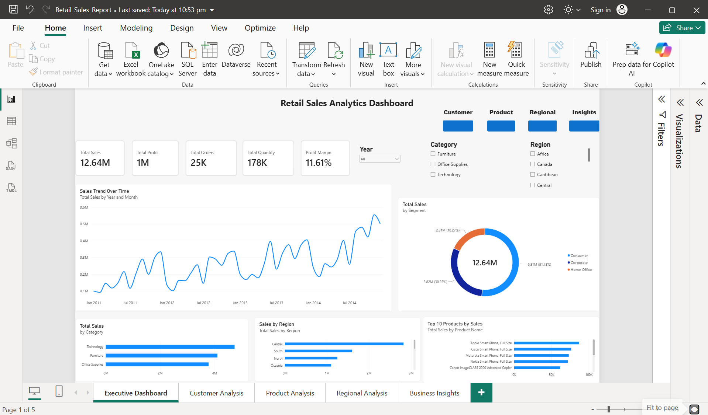
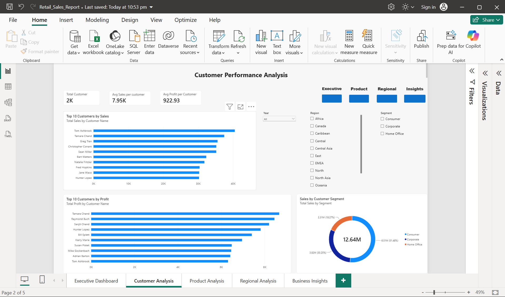
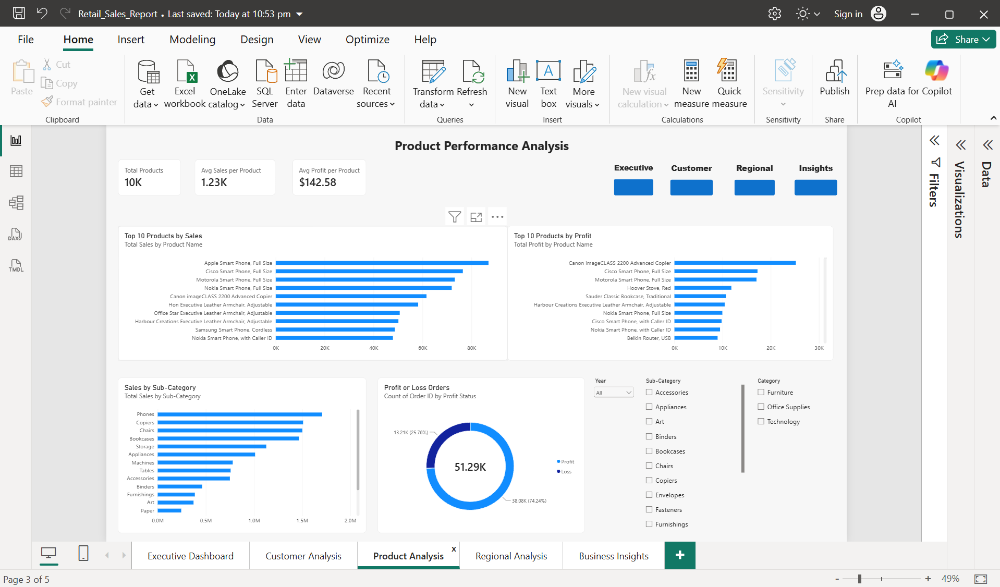
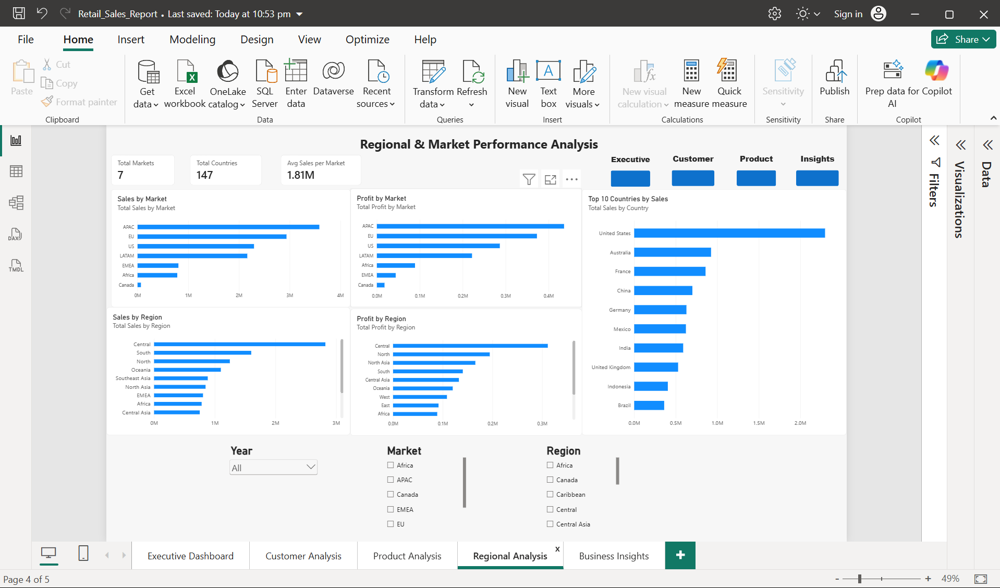
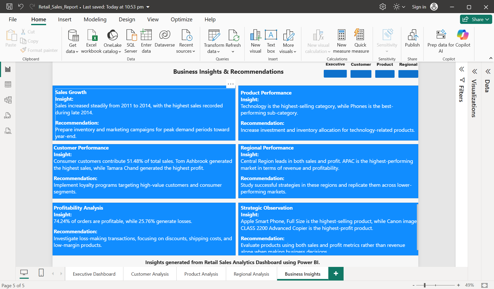

# Retail Sales Analytics Dashboard

## Project Overview

This project presents an end-to-end Retail Sales Analytics Dashboard developed using Power BI.

The dashboard analyzes:
- Sales Performance
- Customer Behavior
- Product Performance
- Regional Performance
- Business Insights

using the Global Superstore Dataset.

## Tools Used

- Power BI
- Power Query
- DAX
- Excel

## Dashboard Pages

### Executive Dashboard
- Sales KPIs
- Profit KPIs
- Sales Trend Analysis
- Category Analysis
- Regional Analysis

### Customer Analysis
- Top Customer by Sales
- Top customer by Profit
- Customer Segment Analysis

### Product Analysis
- Top Product by Sales
- Top Product by Profit
- Sales by Sub-Category
- Profit vs Loss Orders

### Regional Analysis
  - Sales by Market
  - Profit by Market
  - Sales by Region
  - Top Countries by Sales
 
### Business Insights
  - Sales Growth Analysis
  - Product Performance Insights
  - Customer Insights
  - Regional Insights
  - Profitability Analysis
 
 ## Key Insights

  - Technology is the highest-selling category.
  - Consumer segment contributes 51.48% of total sales.
  - APAC is the highest-performing market.
  - United States is the highest-selling country.
  - 74.24% of orders are profitable.
  - Apple Smart phone, Full Size is the top-selling product.
  - Canon imageCLASS 2200 Advanced Copier is the highest-profit product.
 
  ## Author
  Nagomi251100

  ## Dashboard Screenshots

  ### Executive Dashboard
  

  ### Customer Analysis
  

  ### Product Analysis
  

  ### Regional Analysis
  

  ### Business Insights
  
  
